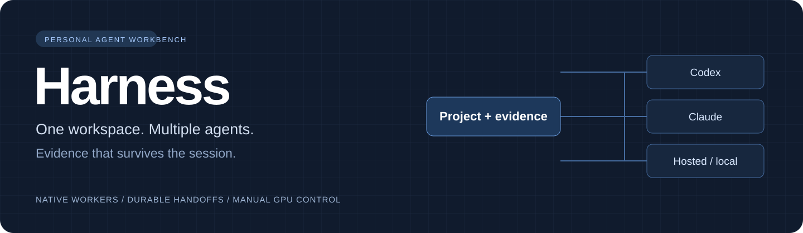
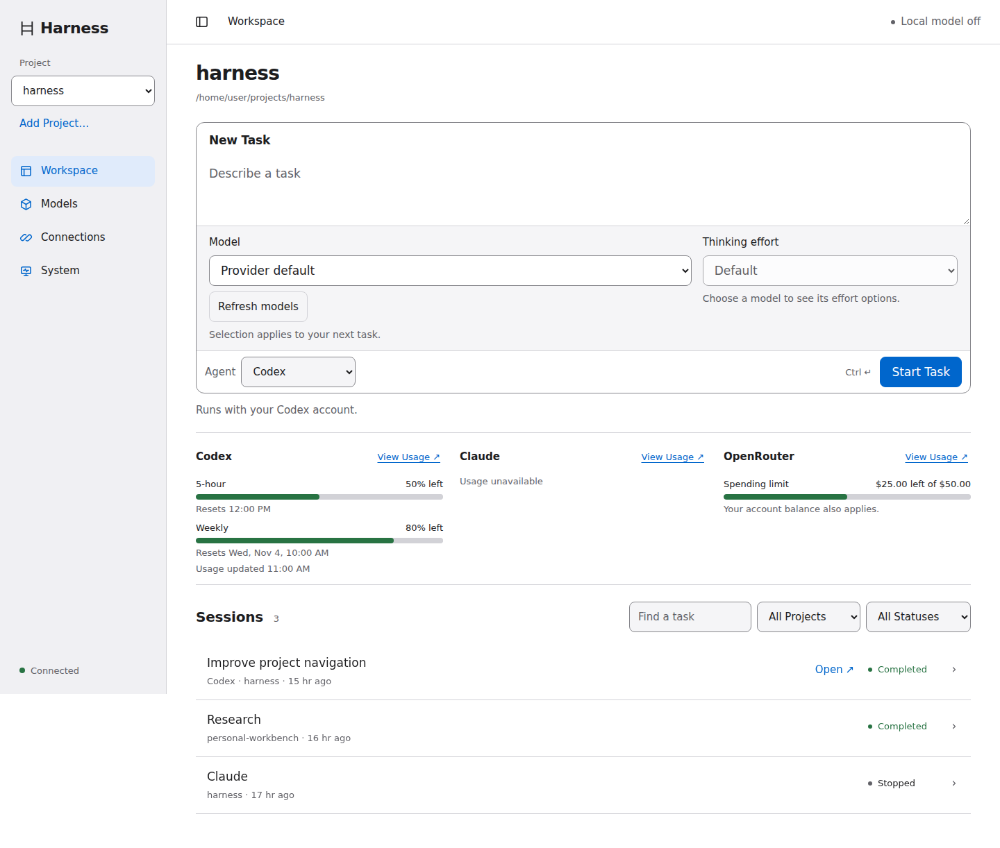
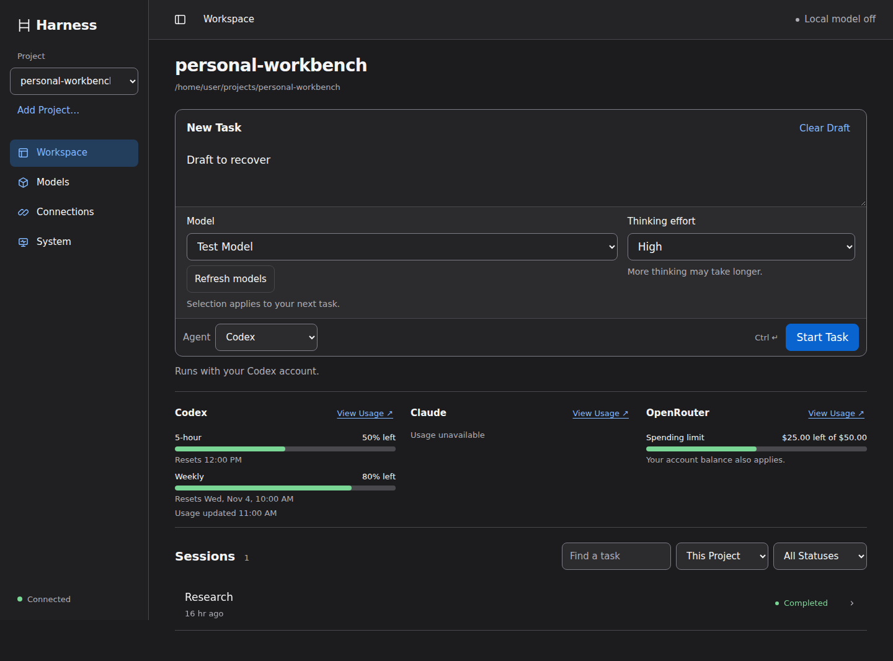
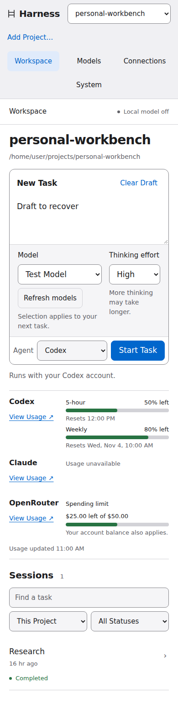
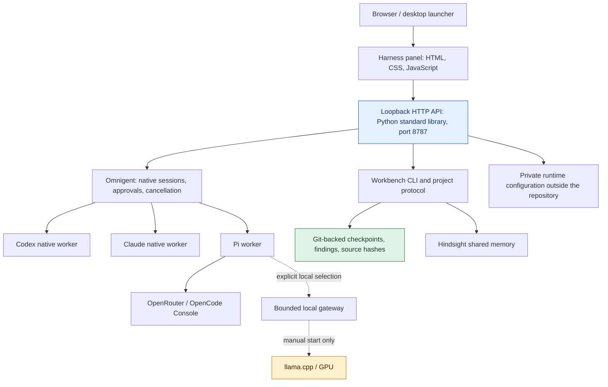
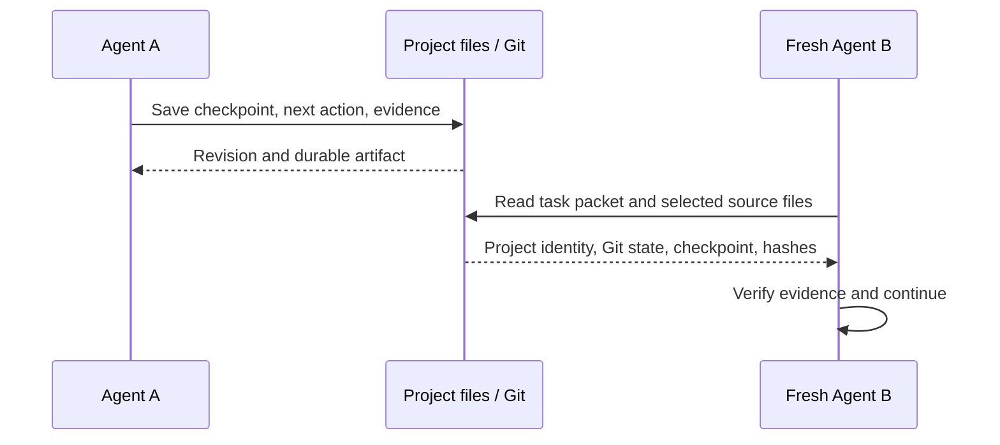
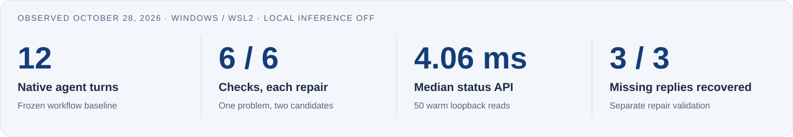
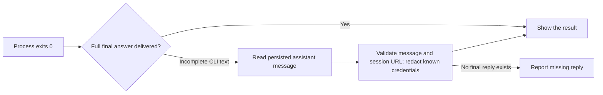

<p align="center"></p>

<p align="center">


</p>

# Harness

I built Harness to make working with multiple AI coding agents feel like one continuous project. I wanted to choose an agent, keep the important context, inspect what actually happened, and pick the work back up without reconstructing everything from chat history.

It brings **Codex, Claude, hosted models, project handoffs, and explicit local GPU controls** into a small personal workbench. My focus is the engineering around the agents: reliable output delivery, durable project state, clear resource controls, and measurements I can trace back to evidence.

**[Architecture](#architecture) · [Benchmarks](#measured-results) · [Run it](#getting-started) · [Design decisions](#decisions-i-made)**

## The workspace



*Actual application UI, rendered with mocked APIs and fictional projects, sessions, and account usage. No live account data appears in these screenshots.*

<table>
<tr><th>Dark appearance</th><th>Phone-width layout</th></tr>
<tr>
<td valign="top"></td>
<td valign="top"></td>
</tr>
</table>

## Why I built it

Switching tools is easy. Carrying the right decisions, evidence, and unfinished work between them is harder. I wanted a workspace where I could:

- Start work with my existing Codex or Claude account, then open its native session for approvals and follow-up.
- Save a handoff with an exact next action and source evidence, so another agent can continue from a real artifact.
- Choose a hosted provider or local model explicitly, with model and thinking-effort controls where supported.
- Keep my GPU available for other work. Opening the app, checking status, and dispatching a team must never silently start local inference.
- Distinguish a successful process, a correct artifact, and a result that was actually delivered.

I used coding agents throughout development. My role was to define the workflows and constraints, compare architecture options, direct the iterations, and use the checks and benchmark evidence to decide what to keep. This repository documents the implementation and its limits rather than presenting generated output as proof on its own.

## Architecture



The control panel is deliberately small. **Omnigent owns sessions and native agent execution**; Harness adds the project workflow, local control plane, provider setup, and evidence-oriented UX. Pi provides the existing path for hosted and local models. Hindsight provides shared memory; Git-backed files preserve exact handoff records.

| Layer | What I implemented here | What I reuse |
| --- | --- | --- |
| Interface | Responsive workspace, session search/filtering, usage states, model controls, accessible dialogs | Browser platform and system typography |
| Control plane | Loopback API, task launch/cancellation integration, final-answer recovery, provider setup | Python standard library |
| Project continuity | Stable identity, checkpoint revisions, bounded packets, source hashes, retryable publication | Git and Hindsight |
| Agent execution | Role/profile configuration and native-worker integration | Omnigent, Codex, Claude Code, Pi |
| Local inference | Explicit start/stop controls and context admission gateway | llama.cpp; model weights are installed separately |

### What a handoff carries



This is explicit, file-based continuity. It does not automatically transfer an entire conversation or synchronize unpushed files across devices. See the [implementation architecture](package/agent-workbench/docs/ARCHITECTURE.md) and [workflow guide](package/agent-workbench/docs/DAILY-WORKFLOW.md).

## Measured results

I kept the first benchmark small enough to inspect: **12 fresh native turns**, run sequentially on Windows/WSL2 on **October 28, 2026**, with synthetic fixtures, a 150-second timeout per turn, and no baseline retries. Local inference stayed off. These results measure the earlier Harness workflow, **not Copilot or a general model leaderboard**.

<p align="center"></p>

| Task | Codex elapsed | Claude elapsed | Observed result |
| --- | ---: | ---: | --- |
| Frozen-source synthesis | 20.08 s | 16.89 s | Both preserved the decision and numbers; Codex incorrectly marked freshness verified from supplied notes |
| Follow-up drafting | 21.21 s | 16.07 s | Both respected the opt-out and draft constraints; no messages sent |
| Async token-cache repair | 44.40 s | 35.93 s | Both passed six external functional checks and changed only the allowed file |
| Live primary-source research | 28.27 s | 24.66 s | Both fetched the official source and returned the required command |

Times include native startup, tool work, and process completion. Each cell is **one observation**, with different native defaults and uncontrolled cache/startup state. The six coding checks are scenarios within **one repair problem**, including 25 concurrent callers, expiry boundaries, retry after failure, and cancellation of owners and waiters.

| Additional measurement | Result | Scope |
| --- | --- | --- |
| Codex → Claude handoff | 33.23 s write / 15.85 s read | Exact marker, next action, project ID, and source hash recovered; reader left files unchanged |
| Claude → Codex handoff | 16.36 s write / 10.25 s read | Same acceptance criteria passed |
| Warm status API, 50 reads | **4.06 ms median · 4.71 ms p95 · 5.45 ms max** | Loopback API only, without a competing benchmark job |
| Baseline complete CLI delivery | **9 / 12 turns** | All 12 processes exited 0; three CLI transcripts omitted parts of the persisted final reply |
| Separate repair validation | **3 / 3 known missing replies recovered** | Plus two new panel turns matching persisted answers; not a new baseline failure-rate estimate |

### The failure that changed the implementation

The most useful result was a delivery bug. A worker could finish correctly and exit successfully while its CLI stream failed to deliver the full answer. I changed the panel to recover the completed assistant reply from the persisted session, distinguish it from tool output, and report an absent reply explicitly.



I preserved the original results and evaluator corrections. I do not turn the repaired behavior into a retroactive baseline success. The same assistant performed post-run adjudication using external checks; this was not an independent blind evaluation. The suite has an unresolved aggregate clock discrepancy, so I make no whole-suite speed claim. Reported cost estimates are not billing data, and missing usage remains unknown.

**Evidence:** [full report](benchmarks/REPORT.md) · [frozen plan](benchmarks/PLAN.md) · [reviewed JSON](benchmarks/results-20261028-v1/reviewed-results.json) · [CSV](benchmarks/results-20261028-v1/summary.csv) · [repair evidence](benchmarks/results-20261028-v1/delivery-repair-evidence.json).

Public evidence is a privacy-sanitized export: personal paths and SSH targets are replaced. Original local files remain unchanged. [Export details](docs/PUBLIC-RELEASE.md) explain which hashes refer to the original run artifacts.

## Decisions I made

| Decision | Reason | Tradeoff |
| --- | --- | --- |
| Reuse native session infrastructure | Keep existing approvals, sign-in, and conversation UI | Integration depends on pinned upstream interfaces |
| Standard-library backend and buildless UI | Keep the panel understandable and easy to inspect | State and accessibility need explicit browser checks |
| Persist handoffs as source-backed files | Make continuation inspectable and portable through Git | Cross-device continuity requires file synchronization |
| Save findings before publishing to memory | Preserve work during outages and allow retries | Remote memory can lag the local durable record |
| Keep unknown usage visibly unknown | Avoid guesses about available quota or actual cost | Some provider usage remains unavailable |
| Make local inference manual-only | Prevent background work from taking over my GPU | Local tasks require a deliberate start and stop |
| Separate content, delivery, and process status | Exit codes alone missed a user-facing failure | More state to validate at completion |

## Verification

The public snapshot passed **36 Python unit tests**. The browser suite checks six widths from **320 to 1440 CSS pixels**, keyboard interaction, drafts, filtering, disconnect recovery, light/dark appearances, increased contrast, forced colors, reduced motion, and 200% text reflow. The detailed acceptance suite has **40 checks**. Browser API writes are mocked; these checks do not launch agents or local inference.

```bash
# From an installed workbench environment:
cd package/agent-workbench
.venv/bin/python -m unittest discover -s tests

# From the repository root, in a separate QA environment with
# Playwright and Chromium/browser system dependencies installed:
python scripts/check-ui.py
python scripts/check-ui-fixes.py --only status,composer,sessions,a11y,copy
```

The frozen cloud-agent benchmark is separate from regression testing. Repeating it launches real cloud-agent turns; it is not part of CI. Read the report's namespace and measurement limitations before a repeat.

## Getting started

The validated environment is **Windows with Ubuntu 24.04 under WSL2**. The installer also has a macOS path, but end-to-end Mac access and real iPhone behavior remain unverified.

```bash
git clone https://github.com/koolestasian/harness.git
cd harness/package/agent-workbench
bash scripts/setup.sh
export PATH="$HOME/.local/bin:$PATH"
workbench configure
workbench auth codex       # or: workbench auth claude
workbench doctor
workbench open
```

The installer installs pinned dependencies and may install missing system prerequisites. Native providers require your own account access. Configure your own memory endpoint/credential and optional hosted provider connection. Credentials belong in private runtime state outside this checkout. Opening the panel does not start GPU inference.

Read the [setup guide](package/agent-workbench/docs/GUIDE.md) for prerequisites, memory, projects, optional local services, and uninstall instructions. Windows setup starts with [`setup-windows.ps1`](package/agent-workbench/scripts/setup-windows.ps1). SSH launchers contain placeholders for your own host.

## Project map

```text
package/agent-workbench/
  desktop_ui.py         Loopback API, task lifecycle, providers, model catalog
  workbench.py          Project identity, handoffs, findings, CLI
  local_gateway.py     Bounded local-model endpoint
  ui/index.html        Responsive, buildless interface
  tests/               Python regression suite
  scripts/             Installers, checks, source packaging
  deploy/              Optional container deployment material
  templates/           Worker roles and project protocol
benchmarks/            Frozen plan, runner, report, sanitized evidence
scripts/               Mocked browser checks and visual capture
docs/                  Design rationale, release notes, visuals
launchers/             Desktop and SSH launchers
```

## Boundaries and next steps

This is a working personal desktop prototype. Paid OpenRouter/OpenCode generation, current local-model generation, large-codebase outcomes, and gaming frame-time effects are not established by the benchmark. Host/origin validation and anti-CSRF checks protect the loopback panel, but it is not a hardened multi-user internet service. Native workers and the controller share an OS account; the tests do not establish adversarial sandbox isolation.

My next direction is a single authenticated project workspace accessible from the phone and editor, with durable submission receipts and an on-demand cloud execution host. **That cloud/mobile architecture is planned work, not a deployed feature of this release.** The current implementation and measured evidence are the foundation I want to improve.

## Acknowledgments

Harness builds on [Omnigent](https://github.com/omnigent-ai/omnigent), [Hindsight](https://github.com/vectorize-io/hindsight), [Codex](https://github.com/openai/codex), [Claude Code](https://github.com/anthropics/claude-code), Pi, and [llama.cpp](https://github.com/ggml-org/llama.cpp). These projects provide the underlying agent/session, memory, and inference capabilities; this repository focuses on the workbench and workflow around them. Upstream packages retain their own licenses and account requirements.
